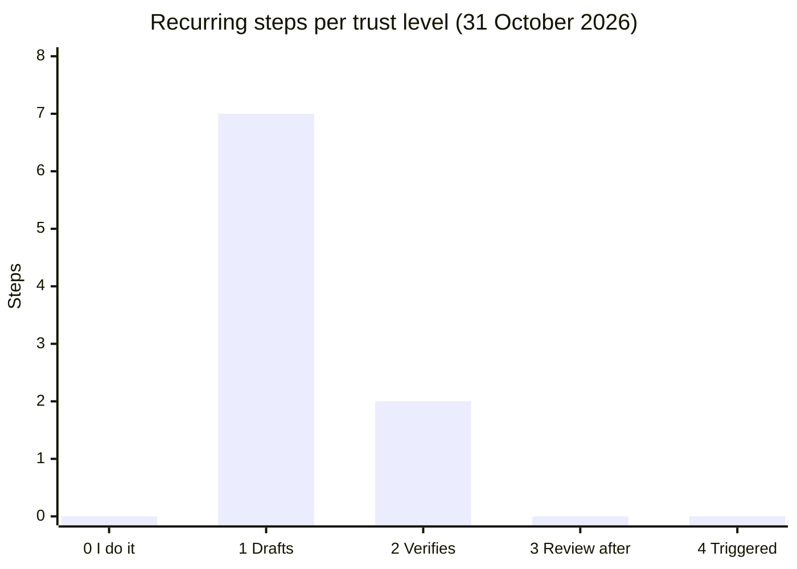
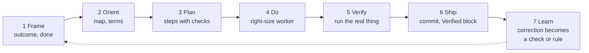

# The trust ladder: how much I let an agent do

The idea is Lauren Tan's. In [her talk](https://www.youtube.com/watch?v=PaPpyQocMww) she goes from watching every output of one agent to agents merging their own changes, one step at a time. Her work is code, which checks itself by running. Much of mine is knowledge work (figures, sources, reports), which cannot, so I climb slower and spend the effort on checks.

## Trust belongs to a step, not a model

Fixing broken links can sit at level 2 while choosing a calculation method stays with me for good.

| Level | Name | Who checks | Allowed for |
|---|---|---|---|
| 0 | I do it | Me | Anything new |
| 1 | Agent drafts | I check all of it | Any step with no automatic check |
| 2 | Agent does and verifies | I read the check's output and a sample | Steps whose check fails on a known-bad case |
| 3 | Review after | I look afterwards | Steps that can be undone (git) |
| 4 | Triggered | Starts on a schedule or event, reports afterwards | Level 3 steps that held for weeks |
| 5 | Never delegated | Me, always | Decisions that change a result, anything sent in my name, confidential data leaving the machine |

A step moves up one level only when all three hold:

1. An automatic check exists, and it fails on a bad case I planted on purpose.
2. The step ran 10 times in a row at its level with no correction from me.
3. The step can be undone.

A miss the check did not catch moves a step down one level, and it gets a new check before it climbs again. Nothing moves without my yes.

## Where I am

Most steps are at level 1 or 2. My register has one row per step. A few:

| Step | Level | Check behind it | Next level needs |
|---|---|---|---|
| Fix errors the notes linter reports | 2 | Lint script, and a gate that blocks edits adding errors | 10 clean runs in a row |
| Code change in a repo with a verify script | 2 | `verify` must print PASS on that commit | 10 merges with no fix-up after |
| Calculation from an agreed inventory | 1 | None automatic yet | A script that recomputes a known case |
| Literature search | 1 | A gate that checks each reference exists | 10 searches where every reference held |
| Prose for a reader | 1 | Style checks only | Stays at 1 where I sign the result |
| Method choice | 5 | Never delegated | Stays |
| Sending a message | 5 | Never delegated | Stays |

The register has 11 recurring steps (31 October 2026).

| Level | Steps | Which |
|---|---|---|
| 1 Agent drafts | 7 | Review draft, inbox sorting, source notes, literature search, inventory calculation, prose, a data list |
| 2 Agent does and verifies | 2 | Linter fixes, code change in a repo with a verify script |
| 3 Review after | 0 | |
| 4 Triggered | 0 | |
| 5 Never delegated | 2 | Method choice, sending a message |

## One loop for every task

Trust is built at stations 5 and 7. Stations 2 and 7 are my weak ones: 2 needs a map per project, and 7 needs a trigger other than my memory.

## The plan to climb

| # | Step | State |
|---|---|---|
| 1 | Set a starting level for every recurring step | Done |
| 2 | Weekly review reads the week's corrections, proposes fixes and level moves | Built. Has run once |
| 3 | Boring work first: linter fixes, inbox sorting, review draft | Next. Linter fixes need 10 clean runs |
| 4 | One card per project: map, terms, steps, checks, levels (fixes station 2) | Not started |
| 5 | One check per kind of knowledge work: recompute a figure, open a cited page | Not started |
| 6 | Schedule steps that held at level 3 for weeks (level 4) | Not started |

If four weekly reviews pass with the loop running and my corrections per session do not fall, the fixes are too soft and I change the plan.

## Who builds, who validates

| Job | Who |
|---|---|
| Frame | Me and the main session. Missing outcome or done conditions: the agent asks first |
| Build | A worker on the smallest model that does the job ([model-tiers.md](model-tiers.md)) |
| Validate | A script, a hook or a second model, never the builder. A builder that grades itself passes itself |
| Decide | Me. A model proposes methods, never chooses one that changes a result |

The builder reports in the [Verified block](verified-block.md), and its report is a lead until the main session opens the source.

## The check comes before the build

1. **Done is written first:** observable conditions, agreed before work.
2. **A repo gets its verify script before it gets changes:** one command that runs the real program on a small fixed input, compares with a known-good output and ends in `verify: PASS` or `verify: FAIL at <step>`.
3. **The check must prove it can fail.** I break one thing in a scratch copy. A check that still says PASS is not trusted.
4. **A hook holds the line.** If code changed after the last PASS, the reply stops until verify runs again. In my main code repo a merge needs a PASS on that exact commit.
5. **Code I answer for is explained first:** a plain note, then my yes.

Other stress tests:

- Before a change ships, the agent hunts for breakage outside the diff and proves safety with real code.
- Each skill test has a boundary case it must refuse. See [skills](../skills/).
- The judge is a different model from the runner, and tests run blind in a throwaway copy.
- "Did this fix it?" is the same check run twice, with the verdict verified, not verified or inconclusive.

A rule I correct twice moves up: written only, then a skill, then a check, then a hook. See the [rules table](rules.md).

## What does not work yet

- The loop that turns corrections into fixes runs only at my weekly review. For its first three weeks it did not run: its two skills needed typing by hand and I never typed them.
- A script can confirm a source opens at the cited page, not that it supports the claim. That stays with me.
- Nothing runs at level 4 yet.

## Credit

The ladder, verification first, skills from observed failures, tests for skills and hard rules over soft rules are from Lauren Tan's talk. "Start with boring, checkable work" and "let the agent interview you first" are Matt Pocock's. The levels table, promotion rule and split by kind of output are my fit of them.
