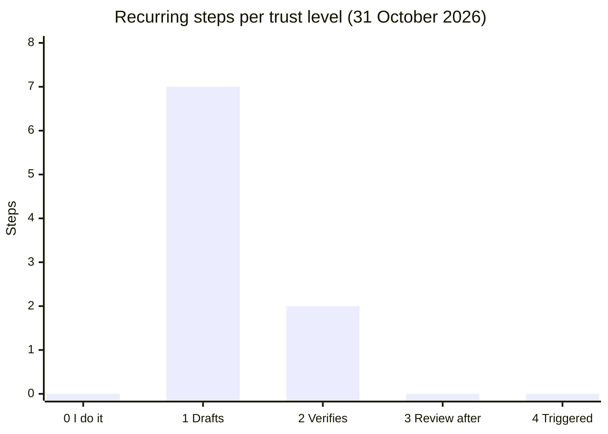
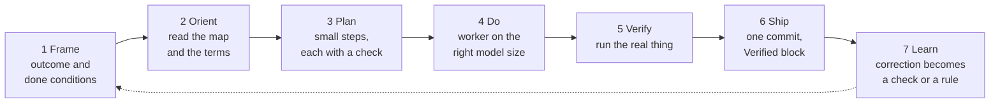

# The trust ladder: how much I let an agent do

The idea is Lauren Tan's. In [her talk](https://www.youtube.com/watch?v=PaPpyQocMww) she
describes how she went from watching every output of one agent to agents merging their own
changes, and her point is that this trust is built step by step, never assumed. As long as
I have to watch one agent's output, I cannot run several, and the agent saves me little.

This page is how I apply that to my own work. Her work is code, which can check itself by
running. Much of mine is knowledge work (figures, sources, reports), which cannot, so my
climb is slower and most of the effort goes into building checks.

## Trust belongs to a step, not to a model

I do not ask "do I trust the agent?". I ask it per recurring step. Fixing broken links can
sit at one level while choosing a calculation method stays with me for good.

| Level | Name | Who checks | Allowed for |
|---|---|---|---|
| 0 | I do it | Me | Anything new |
| 1 | Agent drafts | I check all of it | Any step with no automatic check |
| 2 | Agent does and verifies | I read the check's output and a sample | Steps with a check that fails on a known-bad case |
| 3 | Review after | I look at the result afterwards | Steps that can be undone (git) |
| 4 | Triggered | Starts on a schedule or event, reports afterwards | Level 3 steps that held for weeks |
| 5 | Never delegated | Me, always | Decisions that change a result, anything sent in my name, anything confidential leaving the machine |

## Moving up, moving down

A step moves up one level only when all three hold:

1. There is an automatic check, and it fails on a bad case I planted on purpose.
2. The step ran 10 times in a row at its current level with no correction from me.
3. The step can be undone.

A step moves down one level on any miss the check did not catch, and it gets a new check
before it may go back up. Nothing moves without my yes.

## Where I am

Honest state: most of my steps are at level 1 or 2. I keep a register with one row per
recurring step, the check behind it and what the next level needs. A few rows, in general
terms:

| Step | Level | Check behind it | Next level needs |
|---|---|---|---|
| Fix errors the notes linter reports | 2 | The lint script, and a gate that blocks an edit adding new errors | 10 clean runs in a row |
| Code change in a repo with a verify script | 2 | `verify` must print PASS on that commit before a reply or a merge | 10 merges with no fix-up after |
| Calculation from an agreed inventory | 1 | None automatic yet | A script that recomputes a known case and matches |
| Literature search | 1 | A gate that checks each reference exists | 10 searches where every reference opened and held |
| Prose for a reader | 1 | Style checks only | Stays at 1 where I sign the result |
| Method choice | 5 | Never delegated | Stays |
| Sending a message | 5 | Never delegated | Stays |

## Progress

The register has 11 recurring steps. This is where they stood when I set the starting
levels (31 October 2026). I redraw the chart when a step moves.

| Level | Steps | Which |
|---|---|---|
| 1 Agent drafts | 7 | Review draft, inbox sorting, reading a source into notes, literature search, calculation from an inventory, prose for a reader, a data list for a colleague |
| 2 Agent does and verifies | 2 | Linter fixes, code change in a repo with a verify script |
| 3 Review after | 0 | |
| 4 Triggered | 0 | |
| 5 Never delegated | 2 | Method choice, sending a message. These stay here on purpose and are not in the chart |

The goal is not to push everything to level 4. It is to move the boring, checkable steps
up and keep the decisions with me.

## The structure: one loop for every task

Every task runs through the same seven stations. Trust is built at stations 5 and 7.

Stations 2 and 7 are my weak ones. Station 2 needs a map and a word list per project so
the agent does not search blind. Station 7 is the loop that turns my corrections into
fixes, and it only runs when something other than my memory starts it.

## The plan to climb

In this order. A step is marked done only where it is built and has run.

| # | Step | Why this one | State |
|---|---|---|---|
| 1 | Set a starting level for every recurring step | Without a register there is nothing to move | Done |
| 2 | Make the weekly review read the week's corrections and propose fixes and level moves | The learning loop needs a trigger that is not me | Built. Has run at one review so far |
| 3 | Boring work first: linter fixes, inbox sorting, the review draft | Checkable, undoable, low cost if wrong | Next. Linter fixes are at level 2 and need 10 clean runs for level 3 |
| 4 | One card per project: map, terms, steps, checks, levels | Fixes station 2 | Not started |
| 5 | One check per kind of knowledge work: recompute a figure from its inputs, confirm a cited page opens | Without a check a step cannot leave level 1 | Not started |
| 6 | Put steps that held at level 3 for weeks on a schedule | This is level 4 | Not started |

What would make me change the plan: if four weekly reviews pass with the loop running and
my corrections per session do not fall, the fixes are too soft and the routing is wrong.

## What builds, what validates

| Job | Who does it | Why |
|---|---|---|
| Frame the task | Me and the main session | A task starts with the outcome and the conditions that make it done. If either is missing, the agent asks before it works |
| Build | A worker agent on the smallest model that does the job properly | See [model-tiers.md](model-tiers.md) |
| Validate | A script, a hook or a second model. Never the builder's own word | A builder that grades itself passes itself |
| Decide | Me | A model can propose a method. It does not choose one that changes a result |

The builder still reports in the [Verified block](verified-block.md), and what a worker
reports is treated as a lead until the main session has opened the source itself.

## The check exists before the build

Validation that is added afterwards gets shaped to fit what was built. So the order is
fixed:

1. **Done is written first.** Observable conditions, agreed before any work.
2. **A repo gets its verify script before it gets changes.** One command that runs the
   real program on a small fixed input, compares against a known-good output and ends in
   `verify: PASS` or `verify: FAIL at <step>`.
3. **The check must prove it can fail.** In a scratch copy, one thing is broken on purpose.
   A check that still says PASS is not a check and is not trusted.
4. **A hook holds the line.** If code changed after the last PASS, the reply is stopped
   until verify has run again. In my main code repo a merge also needs a PASS on that
   exact commit.
5. **For code I answer for, the change is explained before it is built.** A short plain
   note, then my yes. I do not ship what I cannot explain in my own words.

## Stress tests

A check that only confirms the happy path builds false trust. What I do to break things:

- **Planted bad cases.** Every check is run against an input that must fail.
- **What could this break outside the diff?** Before a change ships, the agent looks for
  breakage in code the diff does not touch, and proves the one fact the change is safe
  because of by running real code.
- **A boundary case per skill.** Each skill test includes the case the skill must refuse or
  stop on. See [skills](../skills/).
- **The judge is a different model from the runner.** A model does not grade its own run.
- **Blind runs.** A test runs in a fresh throwaway copy with no hints, so the agent cannot
  tell it is a test and nothing it writes reaches the real files.
- **Before and after.** "Did this fix it?" is answered by the same check run twice, with
  one of three verdicts: verified, not verified, inconclusive.
- **Plans get questioned too.** Before a bigger decision the agent interviews me until the
  open questions are found, instead of filling them by guessing.

## Hard rules over soft rules

A written rule holds only while the agent remembers it. So every rule I set sits on a
ladder: written only, then a skill, then a check, then a hook or the structure itself. When
I correct the same thing twice, that rule is the next to move up. The
[rules table](rules.md) shows the rules that already have a mechanism.

## What does not work yet

- The loop that turns my corrections into fixes runs only when I do my weekly review. For its
  first three weeks it did not run at all, because the two skills behind it had to be typed
  by hand and I never typed them. I was the trigger, and that was the weak point.
- Checks for knowledge work are mostly missing. A script can confirm that a source opens at
  the cited page. It cannot confirm that the source supports the claim. That part stays
  mine.
- Nothing of mine runs at level 4 yet.

## Credit

The trust ladder, verification first, skills from observed failures, tests for skills and
hard rules over soft rules are from Lauren Tan's talk. "Start with boring, checkable work"
and "let the agent interview you first" are from Matt Pocock. The levels table, the
promotion rule and the split by kind of output are how I fitted those ideas to my own work.
