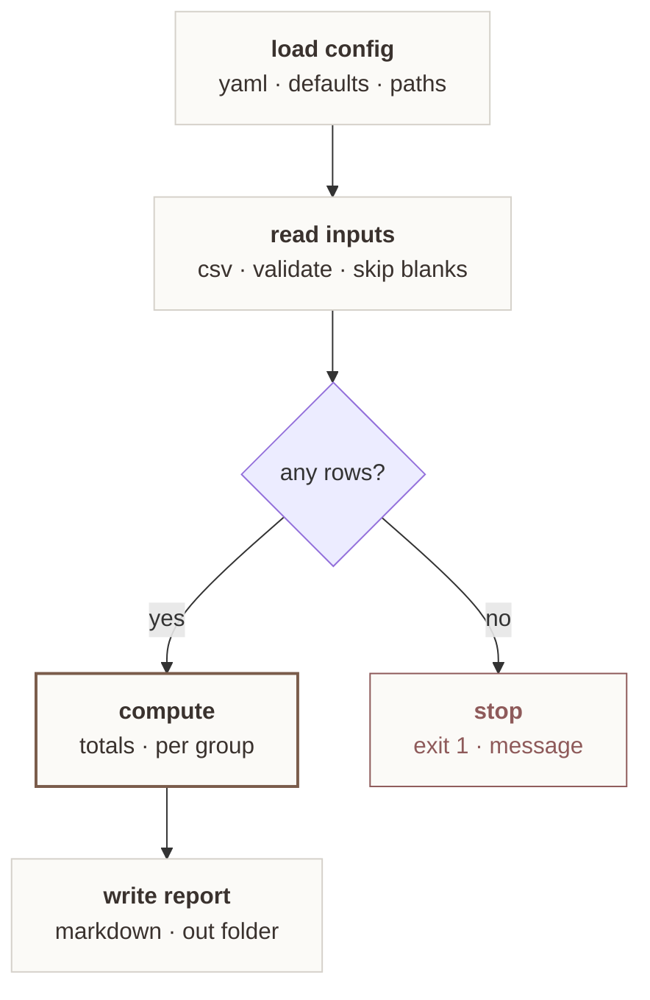

# Code map: the program's steps, drawn

Many people learn code by seeing its shape before its lines. A code map is one Mermaid
flowchart (Obsidian, GitHub and most Markdown viewers draw it with no plugin) where every box
is one step of the program: its name, and under it two to four keywords for what that step
does. A table under the diagram ties each box to `file:line`, so every box can be checked
against the source. Read only: drawing never edits, runs or checks out the code.

## Steps

1. **Find the spine.** Read the entry point and follow the order the program really runs in:
   a list of stages, a `main()`, a loop over inputs, a notebook's cells. For a fixed commit,
   read with `git show <commit>:<path>`, never a checkout (someone else may be working in
   that folder). Done when every box you plan names a function or block you opened and read.
2. **Pick one zoom level** per diagram, as in the C4 model's levels: the whole system
   (processes and data), one program (its steps), or one step (its branches). At most 15
   boxes. A step that needs more gets its own diagram at the next zoom down, linked from its
   box's table row.
3. **Write each box** as `ID["<b>name</b><br/>keyword · keyword · keyword"]`:
   - the name is the code's own (`load_config`, `compute`), in plain words where the code
     name says nothing;
   - keywords are nouns or short verb phrases, separated by ` · `, two to four: the words
     you would use to explain the step aloud;
   - decisions are diamonds `ID{"question?"}` with labelled edges (`-- yes -->`);
   - an edge carries a label when data passes that a reader would not guess
     (`-. rows .->`);
   - an optional step (a switch, off by default) has a dashed border; the one step the map
     is about gets the accent. One accent per diagram;
   - **every exit** of the code drawn gets a box or an edge: each `return`, each `except`
     that ends the work, each early stop and each default written without the main path (an
     answer written without a call, a cell left blank on failure). Done when you have listed
     every `return` and `except` in the functions drawn, with their lines, and each one ends
     in a box.
4. **Add the table** under each diagram: `Step | Where (file:line) | Keywords | What it does`,
   one plain sentence per row. Line numbers at the commit read in step 1, and that commit
   named above the diagram.
5. **Check the render.** Mermaid breaks silently on a few things: quotes or brackets inside a
   label left unescaped (use `#quot;` or reword), `end` as a bare ID, a `<br>` without the
   slash. Open the note in its viewer and look at the drawing; when that cannot be done from
   the session, render the same block once in a browser with mermaid from a CDN and read
   the result. Done when it draws with no error and every box is readable.

## Look

A calm default palette (swap in your own):

```
classDef step fill:#FBFAF7,stroke:#D5D1CA,color:#3A322E
classDef focus fill:#FBFAF7,stroke:#7A5C4B,stroke-width:2px,color:#3A322E
classDef optional fill:#FBFAF7,stroke:#877E79,stroke-dasharray:4 3,color:#3A322E
classDef flag fill:#FBFAF7,stroke:#8E5A5A,color:#8E5A5A
```

`flag` marks a box tied to a finding or a bug, with the finding's number in its keywords.
Top-down (`flowchart TD`) for a sequence; left-right (`flowchart LR`) when there are three or
fewer steps per row.

## Example



| Step | Where (file:line) | Keywords | What it does |
|---|---|---|---|
| load config | `run.py:12` | yaml · defaults · paths | Reads the settings file and fills in defaults. |
| read inputs | `run.py:30` | csv · validate · skip blanks | Loads the input rows and drops empty ones. |
| any rows? | `run.py:44` | | Stops when nothing is left to process. |
| compute | `run.py:51` | totals · per group | Sums the values per group. |
| write report | `run.py:70` | markdown · out folder | Writes the result table. |
| stop | `run.py:46` | exit 1 · message | Ends with an error message when the input was empty. |

(The example is invented to show the shape.)

## Where it goes

- Into the note that asked for it (a review, a design note), or as its own note
  `<Program> code map <date>.md` beside related notes.
- Code under a confidentiality agreement: structure only. A box names functions and steps,
  never a client, a figure or a value from the data, so the map is safe to share.
- If the user wants it in chat right now instead of a note, render the same diagram inline;
  the table stays in the reply.
